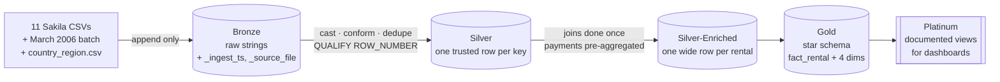
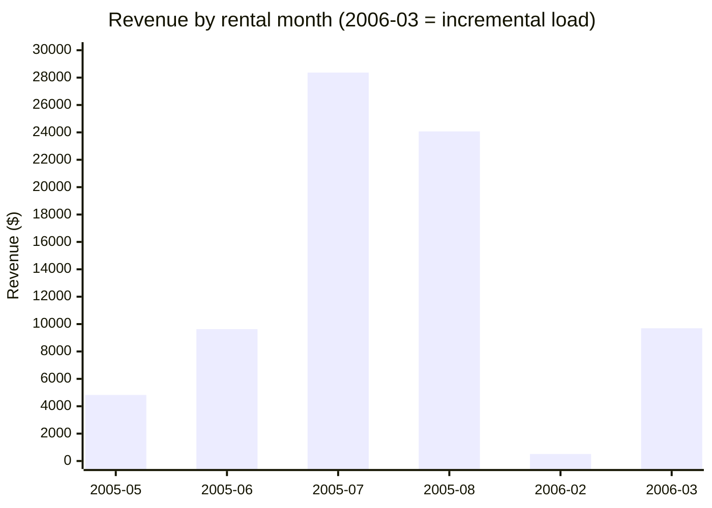
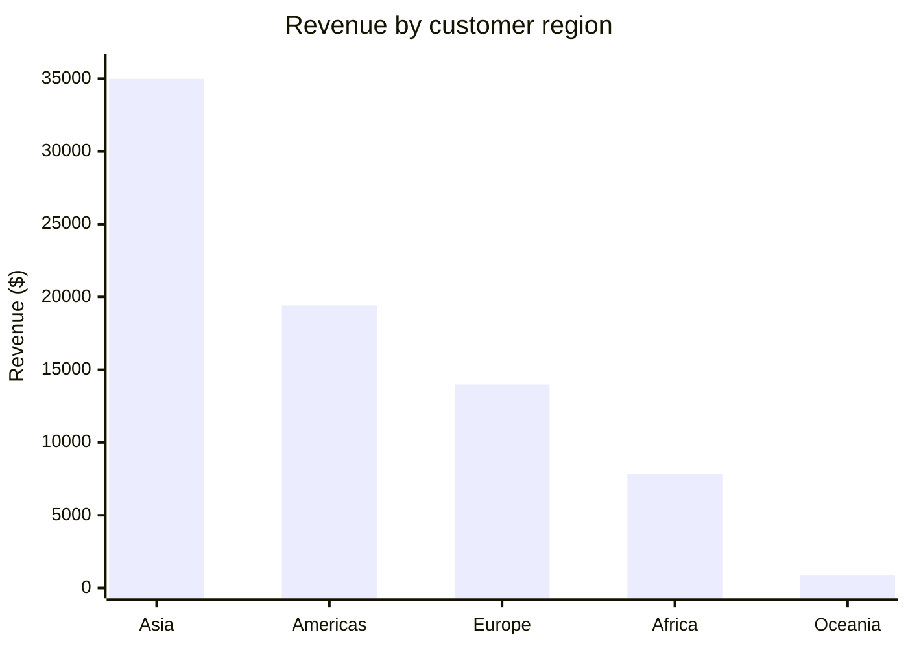

# Sakila Medallion Lakehouse on Databricks

A five-layer lakehouse (Bronze → Silver → Silver-Enriched → Gold → Platinum) built on Databricks Free Edition with Delta Lake and Unity Catalog, followed by an **incremental load of a new month of data** with deduplication, `MERGE`, Delta history, and time travel.

📓 **[View the executed notebook with all outputs →](sakila_lakehouse.ipynb)**

## Architecture

| Layer | Purpose | One row is | Key decisions |
| --- | --- | --- | --- |
| **Bronze** | Untouched copy of every file that arrived | One line of a source file | All columns kept as strings; `_ingest_ts` and `_source_file` audit columns; append-only, so it is the rebuild source |
| **Silver** | Clean, typed, deduplicated | One rental, payment, customer, … | `CAST` to INT / TIMESTAMP / `DECIMAL(5,2)`; Title Case names, lowercase emails, boolean `active`; junk geometry field dropped; open rentals and 5 rental-less payments kept on purpose |
| **Silver-Enriched** | Do the 9 joins once so nobody repeats them | One rental with film, category, customer, geography, payment | Payments summed per rental **before** the join to prevent fan-out; `is_late` is NULL while a rental is still out |
| **Gold** | Star schema for analysts and BI | One rental (fact) / customer, film, store, day (dims) | `fact_rental`, `dim_customer`, `dim_film`, `dim_store`, `dim_date`, plus `revenue_by_category_month` |
| **Platinum** | What a dashboard reads | One point on a chart | `monthly_revenue` and `revenue_by_region_category` views with column comments; business rules (e.g. late % excludes open rentals) live here, not in the dashboard |

## Incremental load: a new month arrives

The source system sends a March 2006 batch: 2,575 rental rows (2,400 new rentals, 150 February rentals that have now been returned, and 25 re-sent duplicates), 2,415 payment rows (including 15 re-sent), and a new `country_region.csv` reference file.

**Row counts at every layer, before and after:**

| Layer | Table | Before | After | Change |
| --- | --- | ---: | ---: | ---: |
| Bronze | `rental_raw` | 16,044 | 18,619 | +2,575 |
| Bronze | `payment_raw` | 16,049 | 18,464 | +2,415 |
| Silver | `rental` | 16,044 | 18,444 | +2,400 |
| Silver | `payment` | 16,049 | 18,449 | +2,400 |
| Silver-Enriched | `rental_enriched` | 16,044 | 18,444 | +2,400 |
| Gold | `fact_rental` | 16,044 | 18,444 | +2,400 |
| Gold | `dim_date` | 267 | 312 | +45 |
| Gold | `revenue_by_category_month` | 80 | 96 | +16 |

Bronze grows by everything that arrived, duplicates included. Every layer above it grows only by the 2,400 genuinely new rentals: the 25 duplicates are removed and the 150 returns update rows that already exist.

### The MERGE that failed, and why that was a good thing

Merging the raw March view straight into Silver failed with `DELTA_MULTIPLE_SOURCE_ROW_MATCHING_TARGET_ROW_IN_MERGE`. The file held 2,575 rows but only 2,550 distinct `rental_id`s. Ten duplicated rentals already existed in Silver, so two source rows tried to update the same target row and Delta refused to guess which one was right.

Deduplicating the source with `QUALIFY ROW_NUMBER() OVER (PARTITION BY rental_id ORDER BY _ingest_ts DESC) = 1` fixed it: **2,550 source rows → 150 updated, 2,400 inserted.**

The more important lesson: the other **15 duplicates were brand-new rentals**. They had no existing row to collide with, so if they had been the only duplicates the MERGE would have **silently inserted 15 extra rentals with no error**. Deduplicating before every MERGE matters even when nothing fails. In production I would also break ties with a reliable change column such as `last_update`, since both copies of a duplicate share the same `_ingest_ts`.

### Verified with Delta history and time travel

- `DESCRIBE HISTORY` shows the MERGE as version 3 with `numTargetRowsInserted = 2400` and `numTargetRowsUpdated = 150`.
- `VERSION AS OF 2` (just before the MERGE) vs. now: **16,044 → 18,444 rows, 2,550 new or changed**, and exactly 150 rentals whose `return_date` went from NULL to a March 2006 date.
- The payments MERGE (my code, Step 4.6) inserted 2,400 and updated 0, as expected.

## Results

| Month | Rentals | Revenue | Late % |
| --- | ---: | ---: | ---: |
| 2005-05 | 1,156 | $4,823.44 | 44.6% |
| 2005-06 | 2,311 | $9,629.89 | 45.9% |
| 2005-07 | 6,709 | $28,368.91 | 45.8% |
| 2005-08 | 5,686 | $24,070.14 | 46.1% |
| 2006-02 | 182 | $514.18 | 100.0% |
| **2006-03** (new) | 2,400 | $9,693.00 | 48.5% |

Revenue by customer region (enabled only by the new reference file): **Asia $34,986.68**, Americas $19,413.69, Europe $13,978.85, Africa $7,857.33, Oceania $863.01. Rental-level revenue after the load is $77,099.56 across 18,444 rentals, with 0 rentals missing a region.

Reconciliation checks in the notebook: enriched rows = Silver rows (no fan-out), and enriched revenue ($67,406.56) is exactly $9.95 below total payments ($67,416.51), the 5 payments with no `rental_id` that a rental-level table cannot hold.

## What I built vs. what was provided

The step-by-step notebook scaffold and datasets were provided by the course. I ran every step in my own workspace and wrote:

- **Step 2.2: Silver payment**: typing (`DECIMAL(5,2)` money, timestamps), `NULLIF(TRIM(rental_id), '')` so the 5 rental-less payments survive as real NULLs, and dedupe on `payment_id` (16,049 rows).
- **Step 4.6: incremental payment MERGE**: a deduplicated view over only the March file, then `MERGE … WHEN MATCHED UPDATE / WHEN NOT MATCHED INSERT` (2,400 inserted, Silver payment 18,449).
- The analysis above, including the before/after reconciliation. I used Claude to explain the medallion layers and the MERGE failure in plain language, and checked its explanation against my own Delta history and row counts.

## Run it yourself

1. Create a free [Databricks Free Edition](https://www.databricks.com/learn/free-edition) workspace.
2. Import `sakila_lakehouse.ipynb` and upload the Sakila CSVs to the `workspace.sakila_bronze.raw` volume (Step 1.2).
3. Run top to bottom, one cell at a time. Step 4.4 is **meant** to fail.

User name and student ID are redacted in the notebook outputs.
