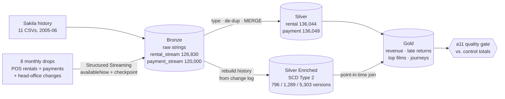
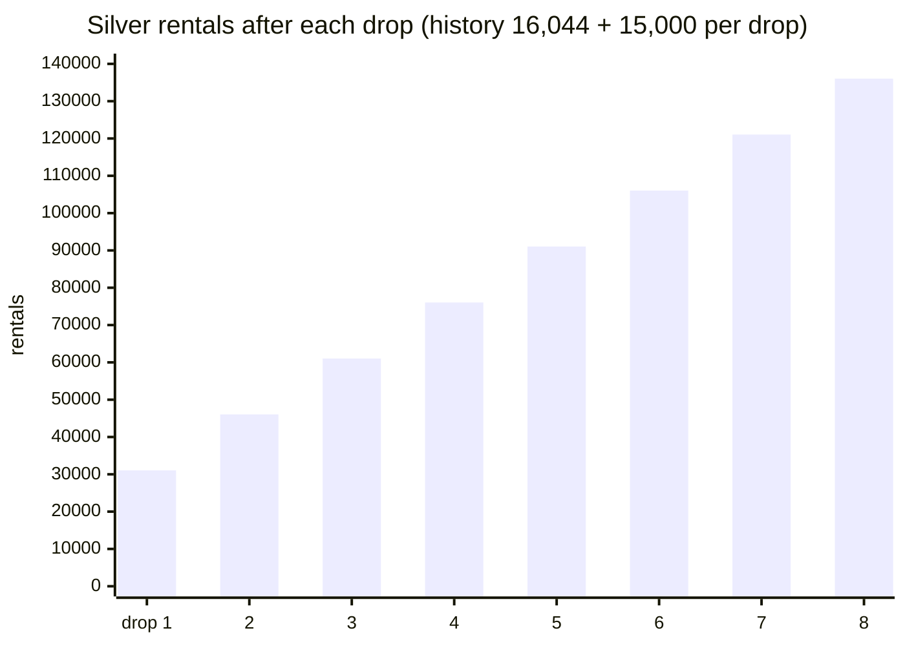
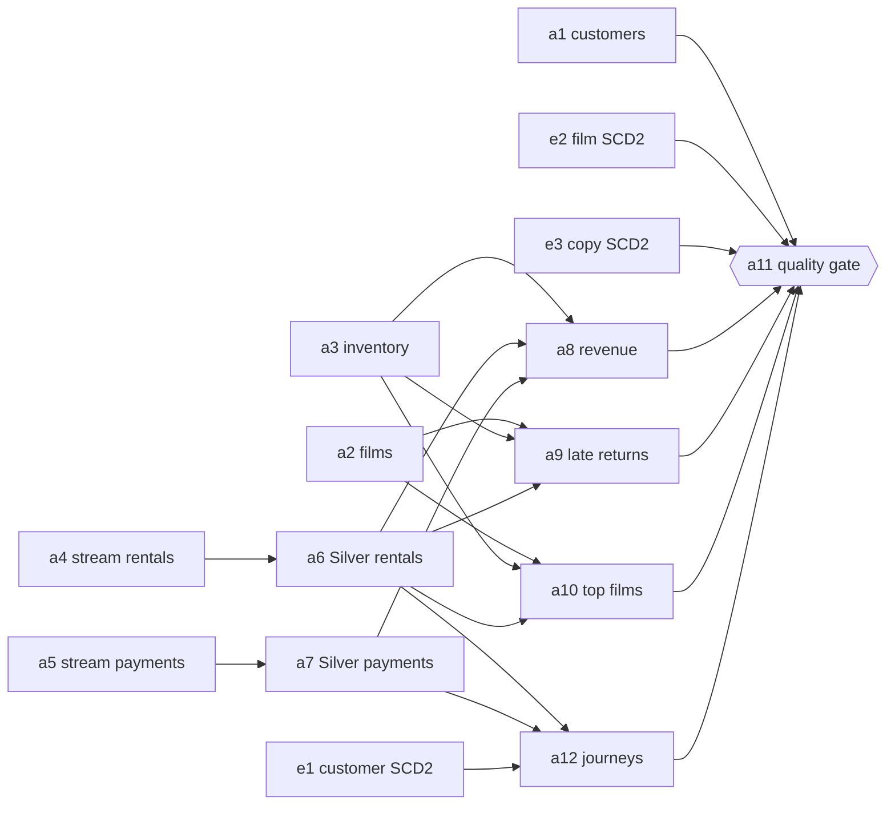

# Debugging a 15-Job Databricks Streaming Fleet: Red to Green Across Eight Data Drops

A Sakila lakehouse running as **fifteen Databricks jobs** (Structured Streaming into Bronze, MERGE into Silver, SCD Type 2 history in Silver Enriched, Gold rollups and customer journeys, and a quality gate). The fleet shipped with **10 planted bugs**. I took it from **3 of 15 green to 15 of 15**, then kept it green through **eight monthly data drops** (136,044 rentals and 136,049 payments by the end), running the whole fleet **twice after every drop** to prove each job is safe to re-run.

📓 **[View the executed deploy notebook with all outputs →](sakila_stream_fleet.ipynb)** · 🛠 **[The fifteen fixed job notebooks →](pipelines/)** · 📋 **[Full fix log →](FIX_LOG.md)**

## Architecture

| Layer | Jobs | What happens to the data | Rows after drop 8 |
| --- | --- | --- | ---: |
| **Bronze** | a4, a5 (Structured Streaming) | Each run appends only the files that landed since the last run (`trigger(availableNow=True)`, one checkpoint per stream). POS retries are kept as they arrived. | `rental_stream` 126,830 · `payment_stream` 120,000 |
| **Silver** | a1, a2, a3 (dimensions), a6, a7 (facts) | Cast strings to INT, `DECIMAL(5,2)` and timestamps (two POS date formats); keep the latest row per key; MERGE late returns into the open rental. | `rental` 136,044 (1,046 still out) · `payment` 136,049 ($606,116.51) |
| **Silver Enriched** | e1, e2, e3 | SCD Type 2 rebuilt from Bronze + every change file: fingerprint the tracked columns, keep a row only when it changes, `valid_to` = day before the next version. | `customers_scd2` 796 · `films_scd2` 1,289 · `inventory_scd2` 5,303 |
| **Gold** | a8, a9, a10, a12 | Revenue by month and store, late returns, top 3 films per category per month, and one row per customer version (the "journey"). | 26 · 64,707 · 624 · 796 |
| **Gate** | a11 | Compares 13 table counts and 2 revenue totals with the control totals sent with each drop. | 15 of 15 green |

An interactive version of this picture, with the fix made in each job, is in [`medallion_layers.html`](medallion_layers.html) (download and open in a browser).

## The debugging story

The first run after drop 1 finished **3 of 15 green**. The bugs came in three kinds, and the last kind is the one that matters in production:

1. **Loud errors** (a Spark exception names the problem): a1 joined `country` on `city_id`; a7 cast money to `INT` (`CAST_INVALID_INPUT '2.99'`).
2. **Silent bugs** (the job runs; only the CHECK against the control totals catches it): a9's `F.col("return_date") != None` is never true in Spark, so it returned **0** late returns instead of 13,695; a10's ranking window had no `partitionBy`, so it returned **3** rows instead of 288; e1 didn't track `store_id`, so 6 store switches never became versions (626 vs. 632); e2 set `valid_to` to the next version's start date, so **42** versions overlapped by one day; a8 joined payments to rentals on `customer_id`, multiplying revenue.
3. **Delayed bugs** (green on the first run, red later):
   - **The second run.** a4 built its checkpoint path with `uuid.uuid4()`, so every run started a fresh checkpoint and re-read every file. Bronze doubled to **30,122 rows against 15,061 landed**. Silver stayed green, because my de-dup in a6 hid the duplicates; only the quality gate caught it. Fix: a fixed checkpoint path, then `reset_stream("rentals")` to replay each file exactly once.
   - **Drop 3.** The point-of-sale system switched its dates to `MM/dd/yyyy` and a6 failed with `CANNOT_PARSE_TIMESTAMP '05/14/2006 22:33:00'`. Parsing both formats was not enough on its own: "latest row per rental" sorted `last_update` **as text**, and `"2006-04-…"` sorts above `"05/…"`, so the job would have kept a re-sent rental's old open row instead of its returned row. Fix: `try_to_timestamp` with both formats, and sort by the parsed timestamp.

A fourth problem was not a planted bug: on serverless, `q.recentProgress` returned `None` for `numInputRows`, so a4 and a5 crashed on a summary `print` **after** the stream had already written its data correctly. I fixed the print with `(p["numInputRows"] or 0)` and logged it separately.

Every fix was a one-line (or one-function) change, and no CHECK cell was edited. The full table, with the error, kind of failure, cause and changed line for each break, is in **[FIX_LOG.md](FIX_LOG.md)**.

| Job | Drop | Kind of failure | Evidence |
| --- | :---: | --- | --- |
| a1_silver_customers | 1 | code error | `UNRESOLVED_USING_COLUMN_FOR_JOIN` |
| a4_stream_rentals | 1 (2nd run) | duplicates or re-runs | Bronze 30,122 vs. 15,061 landed |
| a6_silver_rentals | 1 | duplicates or re-runs | 61 `rental_id`s twice (POS retries) |
| a6_silver_rentals | 3 | schema or format change | `CANNOT_PARSE_TIMESTAMP` |
| a7_silver_payments | 1 | code error | `CAST_INVALID_INPUT '2.99'` |
| e1_enriched_customers_scd2 | 1 | silent logic bug | 626 versions vs. 632 |
| e2_enriched_films_scd2 | 1 | silent logic bug | 42 overlapping versions |
| a8_gold_revenue_by_month_store | 1 | silent logic bug | join fan-out on `customer_id` |
| a9_gold_late_returns | 1 | silent logic bug | 0 late returns vs. 13,695 |
| a10_gold_top_films | 1 | silent logic bug | 3 rows vs. 288 |

## Results

**Green on every drop, twice.** After each of the eight drops the fleet ran twice and both runs were 15 of 15 green. Drops 4 to 8 ran unattended in a loop that landed a drop, ran the fleet twice, and stopped on the first red job (it never stopped).

**SCD Type 2 answers real "what was true then?" questions.**

| Question | Answer (from the Silver Enriched and Gold tables) |
| --- | --- |
| Customer 49's journey | v1: Jedda, Saudi Arabia, store 2, **41** rentals (to 2006-03-14) → v2: moved to Laiwu, China, store 2, **34** rentals (to 2006-04-14) → v3: switched to store 1, **9** rentals so far |
| Film 29's price on 2006-03-10 / 03-31 / 04-20 | **$2.99 / $3.99 / $4.99**, exactly one version per date (no overlaps) |
| Copies that moved store in drop 1 | **98**: 44 to store 1, 54 to store 2 |
| Closed-account versions that still have rentals (after drop 2) | **34** customers. 15 are original Sakila customers whose current `active = 0` flag is copied back to 2005 (a modelling artefact); the versions that start in March or April 2006 hold 544 rentals made after the closure date, a data or process issue worth investigating |

**Reading the query profile** of a8's Gold write (after drop 8):
- The payment scan read all **136,049** rows with a pushed-down `rental_id IS NOT NULL` filter; the 5 payments with no rental are exactly the **$9.95** gap between Silver revenue ($606,116.51) and Gold revenue ($606,106.56).
- Both joins were **Photon Broadcast Hash** joins: inventory (4,581 rows) was broadcast into the join with rental, and that 136K-row result was broadcast into the join with payment, so neither large table was shuffled.
- The **Write Into** step took the most time: 3.30 s of the 5.6 s execution.

## The fleet as one DAG

After drop 8 I put all fifteen notebooks into **one Databricks job** with the dependencies wired by what each job actually reads, rather than by the five fixed waves ([`ec1_pipeline_job.py`](ec1_pipeline_job.py)):

The SCD2 jobs rebuild history straight from Bronze, so they start immediately alongside the dimensions. The job ran green in **1 min 37 s**, against about 5 minutes for the wave-by-wave console run, because independent tasks ran in parallel.

## What I built vs. what was provided

The course provided the deploy notebook: the packed Sakila data, the generator for the eight drops and their control totals, the fifteen job notebooks **with the bugs planted in them**, the job definitions, the console (`land_next_drop()`, `run_fleet()`, `why()`, `reset_stream()`) and every CHECK cell.

My work:
- **Diagnosing and fixing all 10 breaks** (plus the serverless `print` issue), working upstream first, and confirming each fix against the CHECK and the control totals rather than the absence of an error. The [`pipelines/`](pipelines/) folder holds the fifteen job notebooks with exactly those fixes applied; each changed line is marked `# FIX`.
- **The journey analysis**: the Spark queries and answers in Steps 10b and 11b of the notebook (version counts, point-in-time lookups, store moves, closed-account rentals).
- **The query-profile reading** above, confirmed node by node in the Databricks UI.
- **The one-job DAG** ([`ec1_pipeline_job.py`](ec1_pipeline_job.py)) with real data dependencies, and the **layer diagram** ([`medallion_layers.html`](medallion_layers.html)), whose every row count I checked with `spark.table(t).count()`.

## Run it yourself

1. Create a [Databricks Free Edition](https://www.databricks.com/learn/free-edition) workspace (serverless only; nothing to size).
2. Import the course's deploy notebook. In this public copy the packed Sakila data in Step 3 and the packed job notebooks in Step 5 are removed, so you need the original notebook, or the Sakila CSVs uploaded to `/Volumes/workspace/a7_bronze/landing/base/` and the notebooks in [`pipelines/`](pipelines/) imported into `a7_spark_fleet/`.
3. Run Steps 1 to 8, then use the console: `land_next_drop()`, then `run_fleet()` twice, until all eight drops have landed.

## Limitations and next steps

- **a8 still credits revenue to the store that owns each copy today** (`a7_silver.inventory`), which is how the assignment defines it. Copies move between stores, so the historically correct version would join each rental to `inventory_scd2` where the rental date falls between `valid_from` and `valid_to`. I describe that join but did not build it.
- The serverless `numInputRows = None` behaviour was worked around, not root-caused.
- a7 and a8 were fixed in the same pass, so a8's inflated-revenue CHECK failure was never observed on its own; the cause is clear from the code.

## AI-use disclosure

I worked through this with Claude, which read the deploy notebook and the fleet's error report and explained the likely cause of each red job; I made every fix myself in Databricks and accepted it only when the CHECK went green. Claude was wrong several times and I corrected it: it predicted a4 and a5 would pass on the first run (they failed on the serverless `print`), doubted my correct answer of 3 cheaper films, and claimed two customer groups could not overlap (my notebook showed 34 distinct customers, not 35). I also used a Databricks **Genie** space over the Silver Enriched and Gold tables for three journey questions: its SQL was correct (including comparing each version with `version - 1`), but its written explanations claimed things the SQL never computed, so I accepted only the numbers that matched my own Spark results.

User name and workspace host are redacted in the notebook outputs. The notebook's Step 9 cell still shows the original red-fleet report (errors only); later console cells show the final drop 8 runs, because Databricks keeps only each cell's last output.
